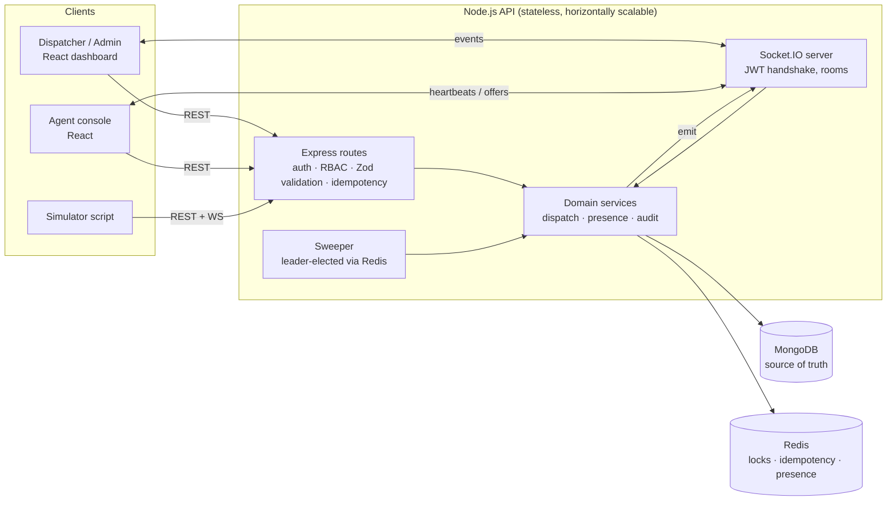
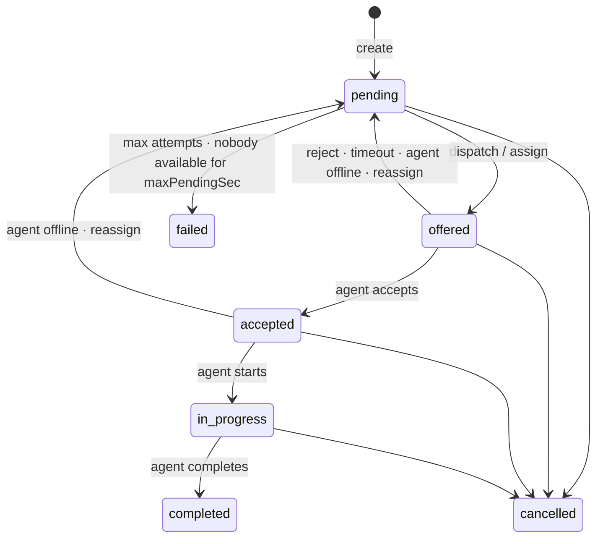

# Real-Time Dispatch & Resource Allocation Platform

A backend that accepts service requests, ranks available agents by **proximity, workload and fairness**, offers the
work to the best agent, and tracks the assignment through **offer → accept → start → complete**. Rejections,
offer timeouts, cancellations, reassignment and agents going offline are handled without corrupting state, even under
heavy concurrent load. A React dashboard shows everything live over Socket.IO.

| | |
|---|---|
| **Backend** | Node.js 20+, Express, TypeScript, MongoDB (Mongoose), Redis (ioredis), Socket.IO, Zod, JWT |
| **Frontend** | React 18 + TypeScript (Vite), Socket.IO client, hand-rolled SVG map (no paid map APIs) |
| **Tests** | Vitest + Supertest + socket.io-client against a real `mongod` (mongodb-memory-server) — **56 tests** |
| **Docs** | OpenAPI 3 at `http://localhost:4000/docs` · this README · [docs/CONCURRENCY.md](docs/CONCURRENCY.md) |
| **Workflow** | Built with AI assistance; later changes made in **CodeZero** and validated as described in [§15](#15-development-workflow-with-codezero) |

---

## Contents

1. [Quick start](#1-quick-start)
2. [Demo walkthrough](#2-demo-walkthrough)
3. [Architecture](#3-architecture)
4. [Domain model & state machines](#4-domain-model--state-machines)
5. [Dispatch algorithm](#5-dispatch-algorithm)
6. [Concurrency & duplicate prevention](#6-concurrency--duplicate-prevention)
7. [Reliability: timeouts, presence, recovery](#7-reliability-timeouts-presence-recovery)
8. [Real-time events](#8-real-time-events)
9. [API reference](#9-api-reference)
10. [Security](#10-security)
11. [Testing](#11-testing)
12. [Project structure](#12-project-structure)
13. [Design decisions & trade-offs](#13-design-decisions--trade-offs)
14. [Assumptions & limitations](#14-assumptions--limitations)
15. [Development workflow with CodeZero](#15-development-workflow-with-codezero)

---

## 1. Quick start

### Option A — zero setup (recommended for review)

Needs only **Node.js 20+**. MongoDB runs in-process (`mongodb-memory-server`) and Redis is replaced by
`ioredis-mock`, so nothing else has to be installed.

```bash
npm run setup        # installs root, backend and frontend dependencies
npm run dev          # API on :4000, dashboard on :5173
```

Open **http://localhost:5173** and sign in with a demo account (one click on the login page):

| Role | Email | Password |
|---|---|---|
| Admin | `admin@dispatch.test` | `Admin@12345` |
| Dispatcher | `dispatcher@dispatch.test` | `Dispatch@12345` |
| Agents | `agent1@dispatch.test` … `agent8@dispatch.test` | `Agent@12345` |

Generate live traffic in a second terminal (agents 2–8 come online, accept/reject/ignore offers; the dispatcher
creates a request every 6 s):

```bash
npm run simulate
```

> The first start downloads a MongoDB binary (~70 MB) for the in-memory server. Data is reset on every restart.

### Option B — real MongoDB + Redis

```bash
docker compose up -d                     # mongo:7 + redis:7
cp backend/.env.example backend/.env     # then set:
#   MONGO_URI=mongodb://localhost:27017/edvexa_dispatch
#   REDIS_URL=redis://localhost:6379
npm run dev
```

Demo users are seeded automatically when the database is empty (`SEED_ON_START=true`).

### Useful commands

| Command | What it does |
|---|---|
| `npm test` | Backend test suite (56 tests, ~15 s) |
| `npm run test:coverage --prefix backend` | Tests with V8 coverage report |
| `npm run typecheck` | `tsc --noEmit` for backend and frontend |
| `npm run build` | Compile API to `backend/dist`, bundle dashboard to `frontend/dist` |
| `npm run simulate` | Synthetic agents + request generator (`-- --no-requests` to only run agents) |

### Configuration (`backend/.env`)

| Variable | Default | Purpose |
|---|---|---|
| `MONGO_URI` | `memory` | MongoDB URI, or `memory` for an in-process server |
| `REDIS_URL` | `memory` | Redis URL, or `memory` for `ioredis-mock` (single process only) |
| `JWT_SECRET` | dev value | **Required in production** (startup fails otherwise) |
| `JWT_EXPIRES_IN` | `12h` | Token lifetime |
| `HEARTBEAT_TTL_MS` | `20000` | Agent is offline after this long without a heartbeat |
| `SWEEP_INTERVAL_MS` | `2000` | Background sweeper period (timeouts, presence, queue) |
| `LOCK_TTL_MS` | `10000` | Redis lock TTL for per-request critical sections |
| `CORS_ORIGIN` | `http://localhost:5173` | Allowed browser origins (comma-separated) |

---

## 2. Demo walkthrough

1. **Sign in as Dispatcher.** The live board shows KPIs, the map, the request table, agents and the activity feed.
2. **Run `npm run simulate`.** Agents appear on the map (green = available, amber = busy, grey = offline) and
   requests start flowing. Dashed lines are pending offers, solid lines accepted jobs.
3. **Click any request** to open the drawer: ranked candidates with a score breakdown (distance / workload /
   fairness), the assignment history and the full audit timeline. Use *Auto-dispatch*, *Assign*, *Reassign* or
   *Cancel*.
4. **Open a second browser window as `agent1`** (the simulator leaves agent1 for you). Toggle *Online*, watch an offer
   arrive with a countdown, then accept/start/complete it — the dispatcher view updates instantly.
5. **Let an offer expire** (do nothing) — it is revoked when the timer runs out and offered to the next agent.
6. **Close the agent tab** — after `HEARTBEAT_TTL_MS` the agent is marked offline and its open offers are re-dispatched.
   The simulator's `agent8` does this automatically every 3 minutes.
7. **Sign in as Admin → Dispatch rules** to change weights, radius, attempts and per-priority timeouts live.

---

## 3. Architecture



**Layering.** Routes only do HTTP concerns (auth, permission, validation, idempotency, response shape). All business
rules live in `services/`, which never import Express or Socket.IO. Services publish events through a small
`realtime/emitter` indirection, so they stay testable and transport-agnostic.

**Storage roles.**

| Concern | Store | Why |
|---|---|---|
| Requests, assignments, agents, audit, config | MongoDB | Durable source of truth; conditional updates + unique indexes enforce invariants |
| Per-request mutex | Redis `SET NX PX` + Lua release | Serialises work across API instances, cheap and short-lived |
| Idempotency records | Redis (24 h TTL) | Fast atomic claim, automatic expiry |
| Agent heartbeats | Redis sorted set | O(log n) per heartbeat, no MongoDB write on the hot path |
| Sweeper leadership | Redis lock | Only one instance runs the sweep at a time |

---

## 4. Domain model & state machines

| Collection | Key fields |
|---|---|
| `users` | `email` (unique), `role` (`admin` / `dispatcher` / `agent`), `passwordHash` (bcrypt), `agent` ref |
| `agents` | `status` (`online`/`offline`), `location` (GeoJSON, **2dsphere**), `skills[]`, `activeCount`, `maxConcurrent`, `lastAssignedAt`, `stats` |
| `servicerequests` | `code` (REQ-1001), `category`, `priority` + `priorityRank`, `location` (GeoJSON), `status`, `currentAssignment`, `assignedAgent`, `attempts`, `triedAgents[]` |
| `assignments` | `request`, `agent`, `status`, **`active`**, `mode` (auto/manual), `score`, `distanceKm`, `expiresAt`, `endReason` |
| `auditlogs` | `action`, `entityType`/`entityId`, `request` (correlation), `actor`, `from` → `to`, `meta` |
| `dispatchconfigs` | singleton: weights, radius, attempts, pending timeout, per-priority rules |

**Critical index:** `assignments { request: 1 }` **unique, partial on `{ active: true }`** — at most one live
assignment per request, enforced by MongoDB itself.

### Request lifecycle



Every arrow is a **conditional** update (`findOneAndUpdate({ _id, status: <expected> }, …)`). An update whose
precondition no longer holds matches nothing and is reported as `409 INVALID_STATE` instead of overwriting state.

Assignment statuses: `offered → accepted → in_progress → completed`, or terminal `rejected` / `expired` / `revoked` /
`cancelled`. Leaving an active status always sets `active=false` and returns the agent's capacity slot.

---

## 5. Dispatch algorithm

1. **Search** — `$geoNear` on the agents' 2dsphere index, limited to `maxRadiusKm × priorityRules[priority].radiusMultiplier`.
2. **Hard filters** — `status: online`, has the request's skill (`category`), spare capacity
   (`activeCount < maxConcurrent`), and not in `triedAgents` (agents that already rejected, timed out or were revoked
   for this request).
3. **Score** (each factor normalised to 0–1, weights admin-configurable and normalised):

   ```
   distance = 1 − distanceKm / radiusKm
   workload = 1 − activeCount / maxConcurrent
   fairness = min(1, timeSinceLastAssignment / 30 min)
   score    = (w_d·distance + w_w·workload + w_f·fairness) / (w_d + w_w + w_f)
   ```

   Defaults: distance 0.6, workload 0.25, fairness 0.15. Fairness stops the closest agent from taking every job.
4. **Offer** — try candidates best-first; if one becomes unavailable between ranking and reservation (`AGENT_UNAVAILABLE`)
   move to the next. If none is available the request stays `pending` and the sweeper retries.
5. **Priority rules** — higher priorities search a wider radius, give agents a shorter acceptance window, and the
   pending queue is always drained `priorityRank DESC, createdAt ASC`.
6. **Bounded retries** — a request fails after `maxAttempts` offers (`MAX_ATTEMPTS_REACHED`) or if it stays unassigned
   for `maxPendingSec` (`NO_AGENT_AVAILABLE`).

`GET /api/requests/:id/candidates` exposes the ranking with its score breakdown, so every automatic decision is
explainable in the dashboard.

---

## 6. Concurrency & duplicate prevention

*Short version for the submission: [docs/CONCURRENCY.md](docs/CONCURRENCY.md).*

The rule: **the Redis lock is an optimisation; MongoDB is the guarantee.** Correctness never depends on the lock
holding, because locks can expire (GC pause, slow query, network partition).

### Layer 1 — per-request Redis lock

Every state change of a request (assign, dispatch, accept, reject, cancel, reassign, timeout, offline revocation) runs
inside `withRequestLock(requestId)`:

- acquire: `SET lock:request:<id> <uuid> NX PX 10000`
- release: Lua script that deletes the key **only if the value is still our uuid** (never release someone else's lock)
- API calls wait up to 3 s with jittered retries; background jobs use `waitMs: 0` and simply try again next tick.

### Layer 2 — atomic capacity reservation

```js
Agent.findOneAndUpdate(
  { _id, status: 'online', $expr: { $lt: ['$activeCount', '$maxConcurrent'] } },
  { $inc: { activeCount: 1 } })
```

Check and increment happen in one document write, so ten concurrent offers to an agent with capacity 2 produce
exactly two successes — even across different requests, which the per-request lock does not cover.

### Layer 3 — unique active assignment

The partial unique index on `assignments(request) WHERE active = true` makes a second live assignment for the same
request physically impossible. The losing insert gets `E11000`, releases the capacity it reserved, and returns
`409 ALREADY_ASSIGNED`.

### Layer 4 — conditional state transitions

`pending → offered` is `findOneAndUpdate({ _id, status: 'pending' })`. If it matches nothing (request was cancelled or
another offer won), the caller **compensates**: deactivates its assignment and frees the agent slot.
Accept is conditional on `{ status: 'offered', agent: me, expiresAt > now }`, so a late accept can never revive an
expired offer, and an expiry can never overwrite an accepted job.

### Idempotency (`Idempotency-Key` header)

Required on `POST /requests`, `/assign` and `/reassign`; optional on other writes.

1. `SET idem:<userId>:<key> {processing, sha256(method+path+body)} NX EX 60` atomically claims the key.
2. Concurrent duplicate while processing → `409 IDEMPOTENCY_IN_PROGRESS` (+ `Retry-After`).
3. Retry after success → stored status and body are replayed with `Idempotent-Replayed: true` (stored 24 h).
4. Same key, different payload → `422 IDEMPOTENCY_KEY_REUSED`.
5. Non-2xx responses delete the key so the client can retry.

Agent transitions (accept/start/complete/reject) and cancel are **naturally idempotent**: repeating an applied step
returns the current state with `replayed: true` instead of an error. The dashboard creates one idempotency key per
form, so double-clicks and network retries never create duplicate requests.

### What the tests prove

| Scenario | Result |
|---|---|
| 20 concurrent manual assigns of one request to 20 agents (HTTP) | 1 × `201`, 19 × `409`, one active assignment, total agent load = 1 |
| Same 20-way race **bypassing the Redis lock** (simulated lock failure) | still exactly 1 winner; every loser released its capacity |
| 10 requests racing for one agent with capacity 2 | exactly 2 offers, agent `activeCount` = 2 |
| 10 parallel auto-dispatches across 3 single-capacity agents | exactly 3 offered, 7 waiting, no agent over capacity |
| 10 concurrent creates with the same Idempotency-Key | exactly 1 request stored |
| Accept racing a cancel | final state always consistent (request + assignment cancelled, capacity freed) |
| Late accept racing the timeout sweeper | accept refused (`OFFER_EXPIRED`), offer expires, capacity freed |
| 5 duplicate accepts | 1 real transition, 4 replays, stats counted once |

---

## 7. Reliability: timeouts, presence, recovery

A **sweeper** runs every `SWEEP_INTERVAL_MS`. A Redis leader lock ensures one instance sweeps at a time; each step is
safe to run concurrently anyway.

| Step | Mechanism |
|---|---|
| **Offer timeouts** | Offers carry `expiresAt` (per-priority timeout). Due offers are moved `offered → expired` conditionally, the agent is added to `triedAgents`, and the request is immediately re-dispatched. |
| **Offline detection** | Agents heartbeat every 5 s (`agent:heartbeat` socket event or REST). Each beat is a `ZADD presence:heartbeats <now> <agentId>`. The sweeper pops stale members with a Lua script (`ZRANGEBYSCORE` + `ZREMRANGEBYSCORE` atomically, so a heartbeat racing the sweep is never lost), marks those agents offline, and revokes their offered/accepted work back to the queue. A MongoDB backstop catches agents marked online without any heartbeat entry (e.g. after a Redis flush). |
| **Socket disconnects** | A disconnect alone does **not** mark an agent offline — mobile connections drop constantly. The heartbeat TTL is the single source of truth. |
| **Pending queue** | Pending requests are re-dispatched by priority then age whenever capacity frees up. |
| **Failure** | `MAX_ATTEMPTS_REACHED` or `NO_AGENT_AVAILABLE` move a request to `failed` with an audit entry. |
| **Rejection** | Immediate re-dispatch to the next best candidate, excluding everyone who already declined. |
| **Reassignment** | The target agent is validated **before** the current assignment is revoked, so a bad target never strands a request. |
| **Hot-path writes** | Heartbeats persist `lastSeenAt` to MongoDB at most once per 10 s per agent (throttled by `SET NX EX`). |

Every transition writes an **audit log** entry (actor, from → to, reason, agent, score/distance) correlated by request
id; it is queryable at `GET /api/audit?requestId=…` and streamed to the dashboard feed. Audit writes never fail the
business operation that triggered them (logged loudly instead).

---

## 8. Real-time events

Clients connect with `io(url, { auth: { token } })`; the JWT is verified during the handshake.

| Room | Who joins | Receives |
|---|---|---|
| `dashboard` | admin, dispatcher | every event below |
| `agent:<agentId>` | that agent only | own offers, assignment updates, own profile updates |

| Event | Direction | Payload |
|---|---|---|
| `request:updated` | server → dashboard (+ assigned agent) | full request |
| `assignment:offered` | server → agent | `{ assignment, request }` |
| `assignment:updated` | server → dashboard + agent | full assignment |
| `agent:updated` | server → dashboard + agent | full agent (status, location, load) |
| `audit:event` | server → dashboard | audit entry (activity feed) |
| `agent:heartbeat` | agent → server (with ack) | `{ location?: { lat, lng } }` |

---

## 9. API reference

Interactive docs: **http://localhost:4000/docs** (raw spec: `/docs.json`). All endpoints are under `/api` and, except
login/health, need `Authorization: Bearer <jwt>`.

| Method & path | Roles | Notes |
|---|---|---|
| `POST /auth/login` | public | rate-limited (20/min/IP) |
| `GET /auth/me` | any | |
| `GET /users` · `POST /users` | admin | creating an `agent` user also creates its agent profile |
| `POST /requests` | admin, dispatcher | **Idempotency-Key required**; auto-dispatches if enabled |
| `GET /requests` | admin, dispatcher | `?status=pending,offered&priority&category&agentId&page&limit` |
| `GET /requests/:id` | admin, dispatcher, agent* | detail + assignment history (*agents: only requests offered to them) |
| `PATCH /requests/:id` | admin, dispatcher | only while `pending` |
| `GET /requests/:id/candidates` | admin, dispatcher | ranked candidates with score breakdown |
| `POST /requests/:id/dispatch` | admin, dispatcher | run auto-dispatch now |
| `POST /requests/:id/assign` | admin, dispatcher | `{ agentId }`, **Idempotency-Key required** |
| `POST /requests/:id/reassign` | admin, dispatcher | `{ agentId?, reason? }`, **Idempotency-Key required** |
| `POST /requests/:id/cancel` | admin, dispatcher | `{ reason }`, repeat calls are no-ops |
| `POST /assignments/:id/accept` · `/start` · `/complete` | agent (owner) | naturally idempotent |
| `POST /assignments/:id/reject` | agent (owner) | `{ reason? }`, triggers re-dispatch |
| `GET /agents` · `GET /agents/:id` | admin, dispatcher | `?status&available=true&skill` |
| `PATCH /agents/:id` | admin | skills, capacity, name |
| `GET /agents/me` · `POST /agents/me/status` · `POST /agents/me/heartbeat` · `GET /agents/me/assignments` | agent | presence + own work |
| `GET /config/dispatch` · `PUT /config/dispatch` | read: admin, dispatcher · write: admin | partial updates |
| `GET /audit` | admin, dispatcher | `?requestId&entityId&action&page&limit` |
| `GET /dashboard/summary` | admin, dispatcher | counters + 24 h acceptance rate |
| `GET /health` · `GET /ready` | public | liveness / readiness (Mongo + Redis) |

**Error format** (every error, including validation and 404 routes):

```json
{ "error": { "code": "INVALID_STATE", "message": "Request REQ-1004 is completed and cannot be cancelled", "requestId": "4b1d…" } }
```

| Status | Codes |
|---|---|
| 400 | `VALIDATION_ERROR` (with `details[]`), `INVALID_ID`, `INVALID_JSON`, `BAD_REQUEST` |
| 401 | `UNAUTHORIZED`, `INVALID_TOKEN`, `INVALID_CREDENTIALS` |
| 403 | `FORBIDDEN` |
| 404 | `NOT_FOUND`, `ROUTE_NOT_FOUND` |
| 409 | `INVALID_STATE`, `ALREADY_ASSIGNED`, `AGENT_UNAVAILABLE`, `AGENT_SKILL_MISMATCH`, `OFFER_EXPIRED`, `REQUEST_LOCKED`, `IDEMPOTENCY_IN_PROGRESS`, `EMAIL_TAKEN` |
| 422 | `IDEMPOTENCY_KEY_REUSED` |

Example:

```bash
TOKEN=$(curl -s localhost:4000/api/auth/login -H 'content-type: application/json' \
  -d '{"email":"dispatcher@dispatch.test","password":"Dispatch@12345"}' | jq -r .token)

curl -s localhost:4000/api/requests -H "authorization: Bearer $TOKEN" \
  -H 'content-type: application/json' -H "idempotency-key: $(uuidgen)" \
  -d '{"title":"AC not cooling","category":"repair","priority":"high","location":{"lat":12.97,"lng":77.6}}'
```

---

## 10. Security

- **JWT** (HS256) with role and agent id claims; tokens verified on every REST call and Socket.IO handshake.
- **Permission-based RBAC** — routes require permissions (`request:assign`, `config:update`, …) mapped to roles in one
  table (`middleware/auth.ts`). Ownership is checked in the service layer (an agent can only act on its own
  assignments and only read requests offered to it).
- **Input validation** with Zod (strict objects — unknown fields rejected, coordinates range-checked).
- **Passwords** hashed with bcrypt; login compares against a dummy hash for unknown emails so timing does not reveal
  valid accounts; identical error for wrong email or password.
- `helmet`, CORS allow-list, JSON body limit (100 kB), login rate limit, request ids on every response, secrets
  redacted from logs, production refuses to start with the default JWT secret.

---

## 11. Testing

```bash
npm test
```

Tests run against a **real MongoDB** (mongodb-memory-server, one database per file) so geo queries, unique partial
indexes and conditional updates behave exactly as in production. Redis uses `ioredis-mock` (including Lua `EVAL`).

```
 ✓ tests/lifecycle.test.ts    (21 tests)
 ✓ tests/concurrency.test.ts  (8 tests)
 ✓ tests/auth.test.ts         (10 tests)
 ✓ tests/realtime.test.ts     (4 tests)
 ✓ tests/idempotency.test.ts  (7 tests)
 ✓ tests/scoring.test.ts      (6 tests)

 Test Files  6 passed (6)
      Tests  56 passed (56)

 Coverage (npm run test:coverage): 90.8% statements · 78.6% branches · 90.7% functions
```

The suite was run repeatedly to check for flakiness in the race tests (all runs green).

| File | Covers |
|---|---|
| `concurrency.test.ts` | 20-way assignment races (with and without the Redis lock), capacity races, parallel auto-dispatch, accept vs cancel, accept vs timeout, duplicate accepts, failed accept does not inflate agent stats |
| `idempotency.test.ts` | key required, replay, payload mismatch (422), 10 concurrent identical calls, key release on failure, per-user scoping, retried manual assign |
| `lifecycle.test.ts` | nearest/skill/offline filtering, workload weighting, priority radius, priority queue, pending → failed, full happy path + audit trail, reject → re-dispatch, timeout → re-dispatch, max attempts, ownership, invalid transitions, cancel (idempotent), reassign, reassign to unavailable agent, skill mismatch, edit rules, validation errors, heartbeat offline detection, presence API, dashboard counters |
| `auth.test.ts` | login, generic credential errors, validation, missing/tampered tokens, RBAC matrix, admin config validation, user creation |
| `realtime.test.ts` | handshake auth, offer delivery to the right agent only, dashboard broadcasts, socket heartbeat → online |
| `scoring.test.ts` | Haversine accuracy, score monotonicity, normalisation |

---

## 12. Project structure

```
backend/
  src/
    app.ts, server.ts            Express app factory / process entry (graceful shutdown)
    config/env.ts                Zod-validated environment
    infra/                       mongo, redis, logger (pino)
    lib/                         errors, Redis lock, geo (Haversine)
    middleware/                  auth + RBAC, idempotency, validation, error handler
    models/                      Mongoose schemas + indexes
    services/                    dispatch (core), presence, request, agent, auth, audit, config, scoring
    realtime/                    Socket.IO server, emitter, publishers
    jobs/sweeper.ts              timeouts, offline detection, queue draining
    routes/                      REST routes + Zod schemas
    docs/openapi.ts              OpenAPI 3 spec served at /docs
    scripts/                     seed data, seed CLI, traffic simulator
  tests/                         Vitest suites (see §11)
frontend/
  src/
    pages/                       Login, Dispatcher dashboard, Agent console
    components/                  Map (SVG), requests table, drawer, agents, feed, config, modal
    lib/                         API client (idempotency keys), socket hook, types, formatting
docs/CONCURRENCY.md              Submission note on concurrency
docker-compose.yml               MongoDB + Redis
```

---

## 13. Design decisions & trade-offs

- **Offer/accept model instead of hard assignment.** Real agents can decline or miss notifications; an explicit
  `offered` state with an expiry makes timeouts and reassignment first-class rather than edge cases.
- **No MongoDB multi-document transactions.** They need a replica set, which complicates local setup. Each operation is
  instead a sequence of single-document atomic updates with explicit compensation, guarded by the unique partial
  index. This is the same pattern as a saga and keeps the system correct with a standalone `mongod`.
- **Lock + database guards, not lock alone.** A Redis lock without fencing cannot guarantee mutual exclusion after it
  expires. Treating it as a contention reducer and putting the invariants in the database removes that failure mode.
- **Heartbeats in a Redis sorted set.** Thousands of agents beating every 5 s would be thousands of MongoDB writes per
  second; the ZSET makes presence cheap, and staleness detection is a single range query.
- **`$geoNear` + in-app scoring.** MongoDB narrows candidates using the 2dsphere index; scoring stays in TypeScript so
  weights are configurable and the result is explainable and unit-tested.
- **TypeScript end to end** and a shared JSON shape (`id`, `{lat, lng}`) for REST and socket payloads.
- **Zero-infrastructure mode** so reviewers can run the full system with only Node installed, while the same code runs
  against real MongoDB/Redis via environment variables.

---

## 14. Assumptions & limitations

- **Single tenant, single city.** Synthetic data around Bengaluru; distances are straight-line (Haversine / `$geoNear`),
  not road distances or ETAs.
- **`REDIS_URL=memory` is single-process.** Running several API instances requires real Redis; with a real
  `REDIS_URL`, Socket.IO uses `@socket.io/redis-adapter` so events reach sockets on every instance (verified with two
  instances against Redis 5). The automated suite runs in memory mode, so the adapter path is covered by that manual
  check rather than by CI.
- **`npm audit`** reports advisories only in test tooling (vitest/tinypool/esbuild, dev-only) and in `ioredis-mock`'s
  Lua runtime (`fengari` → `sprintf-js`, moderate), which is used only in `REDIS_URL=memory` demo mode. Fixing them
  needs major-version upgrades of the test tooling, which was out of scope.
- **Compensation instead of transactions** means there is a millisecond window where an assignment document exists
  before the request points to it; the unique index and conditional updates keep that window harmless, and the
  sweeper/next operation always converges.
- **In-progress work is not auto-revoked** when an agent goes offline (they are likely on site); it stays assigned
  and is visible on the dashboard for a dispatcher to cancel or follow up.
- **Agents are not notified when a dispatcher reassigns an accepted job** beyond the `assignment:updated` event.
- **JWTs are not revocable** before expiry (no refresh-token/denylist); deactivating a user blocks `/auth/me` only.
- The dashboard map is a schematic SVG projection, not a tile map, to avoid paid or rate-limited map services.
- Frontend has no automated tests; it was verified manually against the running API and simulator.

---

## 15. Development workflow with CodeZero

After the first version was pushed, the repository was indexed in **CodeZero** (VS Code extension, Claude as the
coding provider). The extension ran in **"asks first"** mode, so every file edit was shown as a diff and approved
before it was written. Screenshots and transcripts are in [`docs/codezero/`](docs/codezero/).

### 1. Understanding the codebase

- **Code Graph** ([screenshot](docs/codezero/01-code-graph.png)) — used to check that the layering holds: `services`
  is the hub that routes, jobs, realtime and scripts depend on; `models` and `infra` are leaves; the frontend is a
  separate cluster with no code dependency on the backend (it talks only through REST and Socket.IO).
- **Codebase walkthrough** ([screenshot](docs/codezero/02-explain.png),
  [full answer](docs/codezero/02-explain-dispatch-flow.md)) — asked CodeZero to trace `POST /api/requests` → offer →
  accept and explain duplicate-assignment prevention. It read the routes, services and models (8 tool calls) and its
  explanation matched the design in [docs/CONCURRENCY.md](docs/CONCURRENCY.md). It also flagged two small gaps, one of
  which turned out to be a real bug (below).

### 2. Changes made with CodeZero

| # | Change | Commit | CodeZero session |
|---|---|---|---|
| 1 | Count `stats.accepted` only after the request transition succeeds (bug found during the walkthrough) | `082a00c` | [prompt](docs/codezero/03-fix-session.png) · [edit approval](docs/codezero/04-edit-approval.png) · [result](docs/codezero/05-fix-result.png) |
| 2 | Socket.IO Redis adapter for multi-instance broadcasting, with clean shutdown | `283e7d6` | [prompt](docs/codezero/06-adapter-session.png) · [edit approval](docs/codezero/07-adapter-edit-approval.png) · [result](docs/codezero/08-adapter-result.png) |

### 3. How each AI-assisted change was validated

Every change went through the same checklist before it was committed: read the full diff, `npm run typecheck`, the
full test suite, and a check aimed at whatever the generated change had **not** proven on its own.

| Change | What CodeZero reported | Gap found in review | How it was closed |
|---|---|---|---|
| Accepted-stat fix | Fix + regression test, 56/56 passing. It noted it had **not** run the new test against the old code. | A test that was never seen failing might not test anything. The test also did not check that the failed accept cleans up after itself. | Re-ran the test with the fix reverted: it **failed** (`expected 1 to be 0`), so it genuinely catches the bug. Added assertions that the assignment ends `cancelled` and the agent's capacity is released. |
| Redis adapter | Typecheck + 56/56 passing. It noted the adapter path is **not exercised** by the tests (they run with `REDIS_URL=memory`) and that `npm install` printed 11 audit advisories. | Passing tests said nothing about the feature itself. The audit warnings needed triage before shipping. | Ran **two API instances against a real Redis 5 server**: a request created on instance B reached a dashboard socket on instance A. A control run without the adapter did **not** deliver it, which confirms the adapter is what makes it work. `npm audit` triage: all advisories are in dev-only test tooling or the memory-mode Redis mock, none of them introduced by this change (documented in §14). |

The second gap CodeZero flagged — `createRequest` only logs a failed immediate dispatch — was reviewed and kept as
intended behaviour: the request is persisted as `pending`, and the sweeper retries it within `SWEEP_INTERVAL_MS`.

**Takeaway:** CodeZero was most useful for navigating the code and for small, well-scoped changes. Its own summaries
were honest about what it had not verified, and those notes were the starting point for the review rather than the
end of it.
